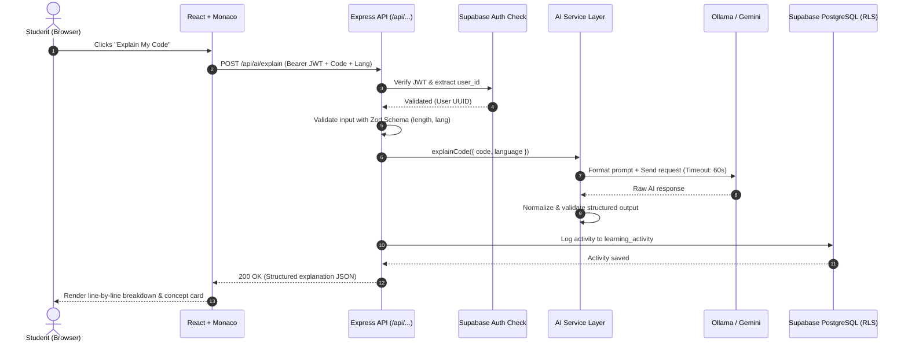

# CodeBuddy AI — System Architecture & Design Specification

> **Target Audience:** First-year B.Tech CSE (AI/ML) students, developers, and system architects.  
> **Tagline:** *Learn to Code. Understand the Logic. Build Confidence.*

---

## 1. High-Level System Overview

CodeBuddy AI is an intelligent, educational programming companion designed to teach Python, C, C++, and JavaScript. Instead of handing students ready-made code that prevents actual learning, CodeBuddy AI acts as a patient teacher. It breaks down code line-by-line, diagnoses errors with actionable explanations, generates tailored practice problems, and delivers progressive hints on demand.

```
+-----------------------------------------------------------------------------------+
|                                 CLIENT TIER                                       |
|  React 19 + Vite + Tailwind CSS + Monaco Code Editor + Recharts + React Router    |
+-----------------------------------------------------------------------------------+
                                         |
                                HTTPS / REST API
                          (Bearer Supabase JWT Token)
                                         v
+-----------------------------------------------------------------------------------+
|                                 BACKEND TIER                                      |
|  Node.js (v20+) + Express.js (ES Modules)                                         |
|  - Security: Helmet, CORS, Rate Limiters, Zod Input Validation                    |
|  - Auth Middleware: Supabase JWT Verification & Claims Extraction                |
|  - MVC Layer: Controllers -> Services -> Repositories                             |
+-----------------------------------------------------------------------------------+
            |                                                      |
            v                                                      v
+-----------------------------+        +--------------------------------------------+
|        DATABASE TIER        |        |               AI SERVICE LAYER             |
|  Supabase PostgreSQL        |        |  Unified Provider Abstraction Interface    |
|  - Profiles                 |        |  (Normalized Request & Response Formats)   |
|  - Conversations & Messages |        +--------------------------------------------+
|  - Practice Problems        |                 |                          |
|  - Practice Attempts        |                 v                          v
|  - Learning Activity Log    |        +-----------------+       +------------------+
|  - Row-Level Security (RLS) |        | Provider A:     |       | Provider B:      |
+-----------------------------+        | Local Ollama    |       | Google Gemini    |
                                       | (gemma3:1b)     |       | Official SDK     |
                                       +-----------------+       +------------------+
```

---

## 2. Core Architectural Principles

### 2.1 The Educational Philosophy (Scaffolding vs. Handouts)
In computer science pedagogy, **scaffolding** refers to providing temporary support structures to students as they develop problem-solving intuition. Giving immediate full solutions leads to the *illusion of competence*. 

CodeBuddy AI enforces a **5-Level Progressive Hint Model**:
1. **Level 1 (Concept Hint):** Reminds the student of the core theoretical computer science concept (e.g., "Think about how 0-indexed arrays work" or "Consider using modulo `%` for cyclic boundaries").
2. **Level 2 (Approach Hint):** Outlines algorithmic thinking (e.g., "Use two pointers moving inward from both ends").
3. **Level 3 (Pseudocode):** High-level structural walkthrough without language-specific syntax.
4. **Level 4 (Partial Code Fragment):** Scaffold containing function signatures, loop setups, or base condition checks.
5. **Level 5 (Full Solution & Educational Walkthrough):** Complete code with step-by-step reasoning, computational complexity ($O(n)$ time/space), and edge-case breakdown.

> **Security Rule:** Unrevealed hints are *never* transmitted to the frontend ahead of time. The server tracks current hint state per student attempt in Supabase and only serves the exact requested level. Level 5 requires an explicit user confirmation.

### 2.2 Provider-Agnostic AI Service Architecture
The frontend never knows whether the response came from a local open-source Gemma 3 model running on the student's laptop via Ollama or Google's Gemini cloud API. 

The backend defines a uniform interface (`AIProvider` contract):
- `generateChat(messages, options)`
- `explainCode({ code, language })`
- `debugCode({ code, language, errorMessage, expectedBehavior })`
- `generatePracticeProblem({ language, difficulty, topic })`
- `generateHint({ problem, level, currentCode })`
- `healthCheck()`

All outputs are normalized into clean JSON shapes with markdown bodies, ensuring predictable rendering.

### 2.3 Sandboxed Execution Safety Policy
Running untrusted student code on an Express web server using `eval()`, `child_process.exec()`, or Python shell scripts is a catastrophic security vulnerability (Remote Code Execution / RCE). A student could accidentally or intentionally run `os.system("rm -rf /")` or fork bombs.

- **Initial Release:** CodeBuddy AI performs static analysis and AI-driven pedagogical inspection. It clearly indicates to the student: *"AI-assisted static analysis; code has not been compiled or executed on a live virtual machine."*
- **Future Isolated Execution Interface:** An abstract `CodeExecutionEngine` interface is prepared for integration with sandboxed runner containers (such as Judge0, Piston, or Docker micro-vms with isolated namespaces, network disabled, cgroup CPU/memory caps, and read-only filesystems).

---

## 3. Component Breakdown

### 3.1 Frontend (`frontend/`)
- **Vite + React 19:** Ultra-fast HMR and lightweight bundle.
- **Tailwind CSS:** Developer-focused dark-first aesthetic (deep navy/slate backgrounds `#0b0f19`, glowing indigo/violet accents `#6366f1`).
- **Monaco Editor (`@monaco-editor/react`):** The exact editor engine powering VS Code, providing students with professional syntax highlighting, bracket matching, line numbering, and indentation.
- **Recharts:** Responsive SVG data visualization for learning streak, language distribution, and problem-solving history.
- **React Router v7:** Client-side routing with route guards (`ProtectedRoute`, `PublicRoute`).
- **Supabase Client:** Handles user session state and auto-refreshes tokens.

### 3.2 Backend (`backend/`)
- **Express.js (ESM):** Modern JavaScript with top-level `import`/`export`.
- **Zod Validation:** Strict schema enforcement on every incoming HTTP body, headers, and query parameters.
- **Centralized Error Handler:** Intercepts synchronous exceptions and unhandled promise rejections, mapping them to structured, safe HTTP error responses without leaking stack traces or internal environment paths.
- **Rate Limiting:** Protects AI endpoints from exhaustion and runaway bills (`express-rate-limit`).

### 3.3 Database & Auth (`Supabase / PostgreSQL`)
- **Row-Level Security (RLS):** Every table links to `auth.users(id)`. PostgreSQL policies (`auth.uid() = user_id`) ensure that User A can never query or mutate User B's practice attempts or chat sessions, even if they guess UUIDs.
- **Audit & Analytics Logging:** A dedicated `learning_activity` append-only table records concept interactions, helping construct accurate student dashboard metrics without synthetic counters.

---

## 4. Request Flow Diagram



